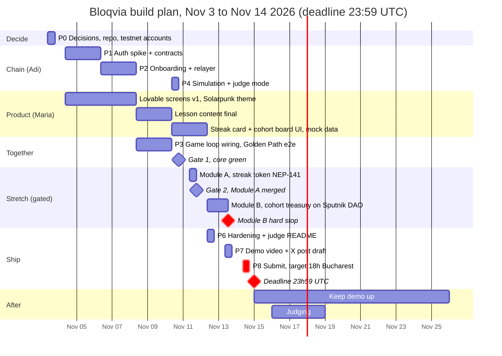
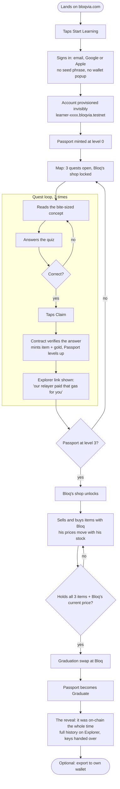
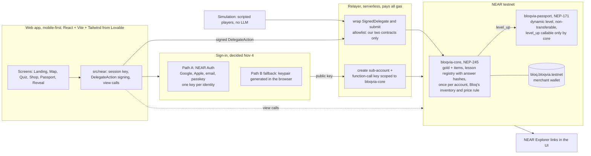
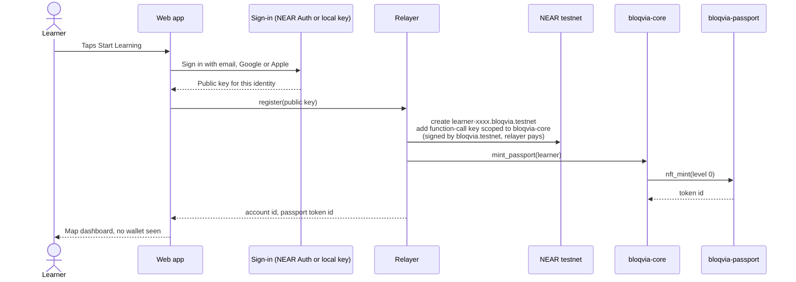
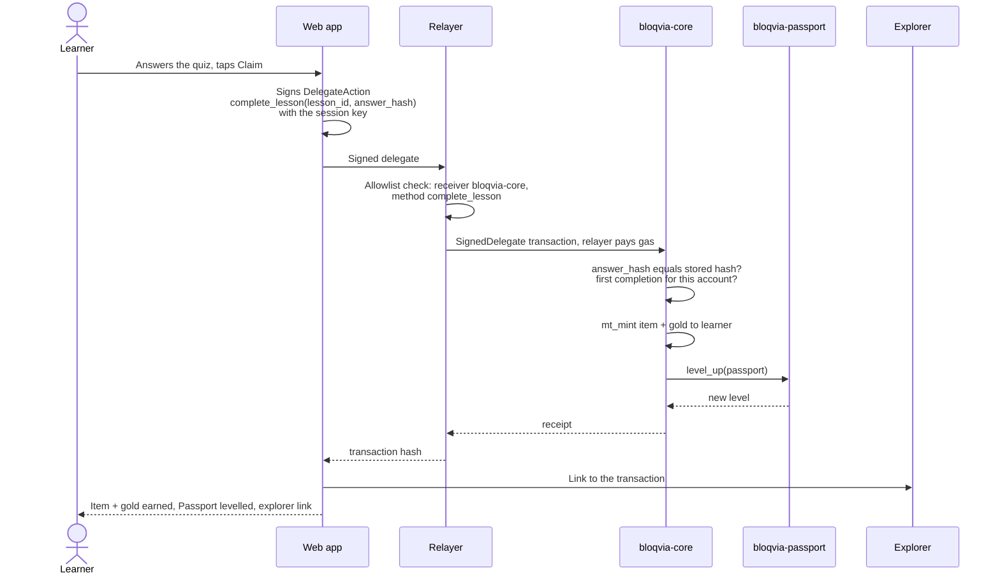
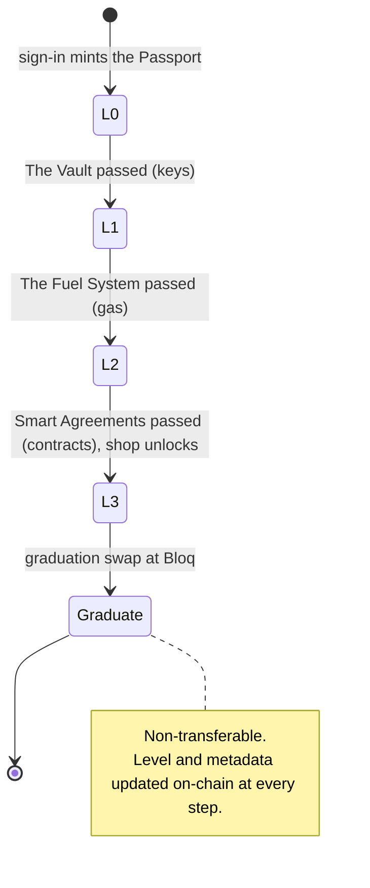
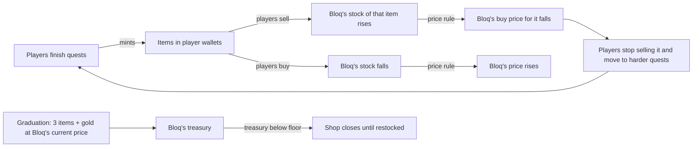

# Bloqvia — flows

User flow, system architecture, sequences, Passport states and Bloq's economy loop. All diagrams are Mermaid and render on GitHub. Source of truth for the plan: the "Bloqvia — Roadmap & Flows" doc.

## Build plan

Gate 1 (Nov 10, 18:00) opens Module A, the streak token. Gate 2 (Nov 11, 18:00) opens Module B, the cohort treasury on Sputnik DAO. Module B has a hard stop at Nov 13, 13:00. Each module lives on its own branch and merges only through its gate.

## User flow: the Golden Path

## System architecture

## Sequence: onboarding

## Sequence: lesson completion

## Passport states

## Bloq's economy loop

