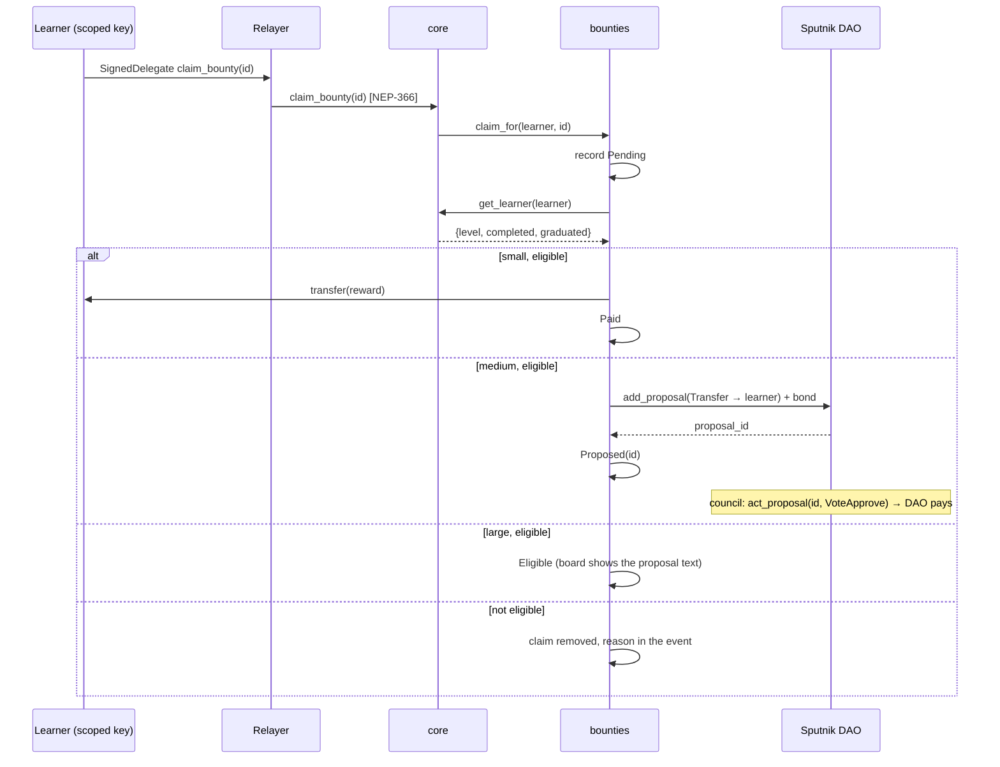

# Module B — the cohort board: a DAO owns the bounties, the chain pays by tier

Branch `module-b`. Hard stop Nov 11, 13:00: not end to end → stays unmerged, `social` not ticked. Everything here is testnet.

## The idea in one paragraph

Graduates are a cohort. A Sputnik DAO (`bloqvia-dao.sputnik-v2.testnet`, council = Adi + Maria) owns a bounty board, `bounties.bloqvia.testnet`. A bounty is a small piece of work for learners ("explain gas to a newcomer in three lines", "finish five daily quests", "reach Passport level 3") with a reward in NEAR and a **requirement the chain can check** against `bloqvia-core`'s own record. Rewards are paid by tier: **small** bounties are paid by the contract itself from an allowance the DAO funded; **medium** ones become a DAO Transfer proposal that the council votes on; **large** ones go through the DAO's normal proposal flow, the board only certifies eligibility. No person moves money by hand; the DAO decides what to fund, the contract decides who qualified.

## Contracts

| Piece | What it does |
| --- | --- |
| `contracts/bloqvia-bounties` (new) | Holds bounties, claims and an allowance. `add_bounty` / `close_bounty`: owner or the DAO (via a FunctionCall proposal). `claim_for(learner, id)`: only `core` may call it (same pattern as `check_in_for`), reads `core.get_learner(learner)` cross-contract, then pays / proposes / certifies by tier. Views for the board. |
| `bloqvia-core` | `set_bounties_contract` (owner), `claim_bounty(id)` (registered learner; forwards `claim_for`), `get_bounties_contract`. The learner's scoped key keeps working. |
| Sputnik DAO v2 | Created from the testnet factory with a 0.1 NEAR proposal bond and a two-member council. Funds the board with a Transfer proposal; approves medium claims with one vote (`act_proposal VoteApprove`). |

### Tiers (fixed at `new()`, readable in `get_config`)

| Tier | Who pays | How | Cap |
| --- | --- | --- | --- |
| Small | the board, at once | `Promise::transfer` from the allowance in the claim's callback | reward ≤ `small_cap` (0.5 NEAR on testnet) |
| Medium | the DAO, after one council vote | the board files `add_proposal(Transfer → claimant)` with the bond; status `Proposed { proposal_id }` | — |
| Large | the DAO, after a normal proposal | the board records `Eligible`; the claimant (or anyone) files the proposal in the DAO; the board shows the exact text | — |

### Requirements the chain checks (one `get_learner` view, no model, no human)

`PassportLevel { min }`, `QuestCompleted { lesson_id }` (founding or `daily-…`), `Graduated`. All require `registered`.

### What cannot happen

- A claim is recorded as `Pending` before any cross-contract call, so two claims in flight cannot pay twice; a failed transfer or a refused proposal removes the claim so the learner can try again.
- The board holds no key to the DAO treasury; medium and large rewards leave the DAO only through its own proposals.
- The contract has no method that changes a reward after a bounty is posted; closing a bounty stops new claims and nothing else.

## Flow

## Plan

| When | What | Done when |
| --- | --- | --- |
| Nov 5 eve | `bloqvia-bounties` + tests; core forwarding + tests; branch `module-b` | `cargo test` green in both crates |
| Nov 6 | DAO created from the factory (Adi, near-cli); `deploy-bounties.sh`; relayer allow-lists `claim_bounty` (gas cap 150 TGas); `useBounties` hook; three seed bounties (one per tier); DAO funds the allowance | a small claim pays a learner on testnet; a medium claim shows up as a DAO proposal and is approved with one vote |
| Nov 7 | Lovable prompt 9: `/cohort` board (bounties, my status, DAO treasury + proposals read from chain, claim button); README section; docs | board live on the preview; Gate 3 review |
| Nov 8–10 | Slack: polish, the "normal proposal" path demoed, X post material | — |
| Nov 11, 13:00 | Merge to `main` or stay unmerged | — |

## Status

- **Nov 5, 14:20 — gate passed, two days early.** DAO created (`bloqvia-dao.sputnik-v2.testnet`, council `bloqvia.testnet`, bond 0.1 NEAR, threshold 1 of 2); board deployed with four seed bounties; `scripts/bounty-claim.ts --bounty 1` → `claim: Paid`, learner 0.01 → 0.11 NEAR (tx `GMNgxm1A…`); `--bounty 3` → proposal #0 filed by the board, approved with one `act_proposal` vote, DAO paid 1 NEAR. Merged to `main` the same afternoon; Lovable built the Cohort tab (prompt 9, `8bd038a`), verified from a clean learner: today's quest → Claim → Paid. DAO funded the board by proposal #2 (2 NEAR; #1 for 3 NEAR failed because the DAO must keep ~2.7 NEAR for its own storage — rejected; the DAO was topped up with 4 NEAR from `bloqvia.testnet`). Allowance 2.13 NEAR.
- **Nov 10 — the board after testing.** "Teach one newcomer" (5/5) and "Run a Bloqvia session" (3/3) were used up by the proofs and the simulation; `scripts/bounty-reopen.ts` (`npm run bounty:reopen -- --apply`, signed by the owner) closes any fully claimed bounty and adds a copy with room (Small 100, Medium 25, Large 10), through the contract's own `close_bounty` / `add_bounty`; run at 12:00: #3 → #6 (Teach one newcomer, 0/25), #4 → #5 (Run a Bloqvia session, 0/10). "Today's quest, done" was pinned to `daily-2026-11-05`; now the relayer posts that bounty for the day's quest right after seeding it and closes the previous day's (`relayer/src/bounties.ts`, called from the scheduler and `POST /admin/quest`; the reward is a constant in code, 0.05 NEAR, Small tier). The Missions page lists only open bounties (`src/near/useBounties.ts`); closed ones stay on chain with their claims.
- **Nov 10 — the Passport as a vote.** Two roles on the DAO (`scripts/dao-roles.ts`): `graduates` (vote on Transfer = medium claims) and `founders` (also FunctionCall = what the cohort pays for), one vote decides (testnet). The relayer seats learners from the receipts it relays (`seats.ts`: a `graduate` → graduates; the third Season 2 chapter → founders), by `AddMemberToRole` + the council's approval. New accounts get a second function-call key limited to the DAO's `act_proposal`, so the vote is the learner's own transaction (`accounts.ts`, `policy.ts`: only VoteApprove/VoteReject are relayed). Founders propose bounties: `POST /propose` (`propose.ts`), proof by a message signed with that key, caps per tier, 2 a day per founder; the relayer files the DAO FunctionCall proposal and the founders vote. Missions page: prompt 30.

## Open questions

- [ ] Is the Sputnik v2 testnet factory (`sputnik-v2.testnet`) live? (`get_dao_list` view — Adi runs it Nov 5.)
- [ ] Maria's testnet account for the council (else `council.bloqvia.testnet`, a sub-account Adi holds).
